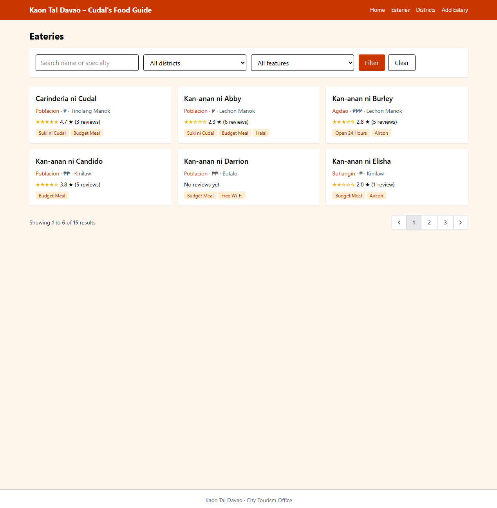
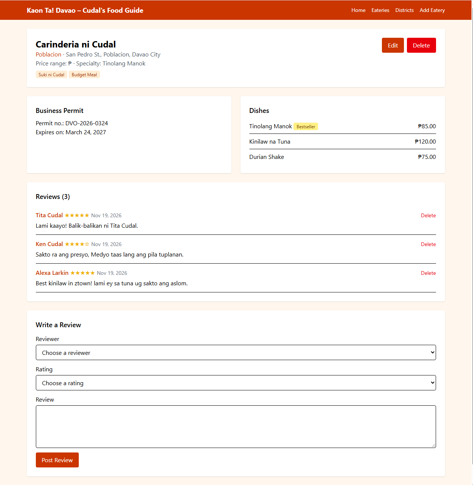
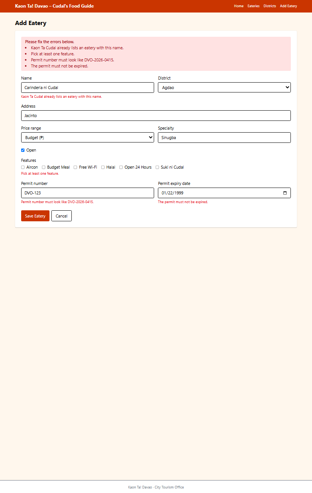

# Kaon Ta! Davao – Carinderia & Eatery Guide

**Name:** Ken Andrew Cudal
**Course:** 4-334 · CS Elective 2 Full-Stack Development (Laravel)
**Project:** Prefinal Milestone Project (Laravel 12, SQLite)

A guide for the Davao City Tourism Office that lists carinderias and eateries by district, with each eatery's business permit, dishes, features, and reviews from residents.

## Setup

```bash
composer install
cp .env.example .env
php artisan key:generate
touch database/database.sqlite
php artisan migrate:fresh --seed
npm install
npm run build        # or npm run dev while developing
php artisan serve
```

On Windows PowerShell, use `copy .env.example .env` and `New-Item database/database.sqlite` in place of `cp` and `touch`.

## Personalized Data

| Item | Value |
|---|---|
| Site title | Kaon Ta! Davao – Cudal's Food Guide |
| Districts | Poblacion, Talomo, Agdao, Buhangin, Toril, Calinan |
| Features | Suki ni Cudal, Budget Meal, Halal, Open 24 Hours, Aircon, Free Wi-Fi |
| User 1 | FIRSTNAME Cudal – cudal@kaonta.test (password: kaonta2026) |
| User 2 | Tita Cudal – tita.cudal@kaonta.test (password: kaonta2026) |
| My eatery | Carinderia ni Cudal (slug: carinderia-ni-cudal), Poblacion, San Pedro St., Poblacion, Davao City, budget, specialty Tinolang Manok |
| My eatery's features | Suki ni Cudal, Budget Meal |
| My eatery's dishes | Tinolang Manok ₱85.00 (bestseller), Kinilaw na Tuna ₱120.00, Durian Shake ₱75.00 |
| Permit | DVO-2026-MMDD, expires 2027-MM-DD |

## Relationships

| Relationship | Type | Why this type fits |
|---|---|---|
| District → Eatery | hasMany / belongsTo | One district has many eateries, but each eatery is in only one district, so `eateries` stores `district_id`. |
| Eatery → Dish | hasMany / belongsTo | An eatery serves many dishes, and each dish belongs to one eatery through `eatery_id`. |
| Eatery → Review | hasMany / belongsTo | An eatery can get many reviews, and each review is about one eatery. |
| User → Review | hasMany / belongsTo | A user can write many reviews, and each review has one writer through `user_id`. |
| Eatery → Permit | hasOne / belongsTo | Each eatery has exactly one permit; `eatery_id` in `permits` is unique so a second permit can't be added. |
| Eatery ↔ Feature | belongsToMany / belongsToMany | An eatery has many features and a feature is shared by many eateries, so the links are stored in the `eatery_feature` pivot table. |
| District → Review (through Eatery) | hasManyThrough | Reviews don't have a `district_id`, so the district reaches its reviews by going through its eateries. |

## Routes

Output of `php artisan route:list --except-vendor`:

```
  GET|HEAD    / ................................................ home › HomeController
  GET|HEAD    districts ............................. districts.index › DistrictController@index
  GET|HEAD    districts/{district} ................... districts.show › DistrictController@show
  GET|HEAD    eateries ................................ eateries.index › EateryController@index
  POST        eateries ................................ eateries.store › EateryController@store
  GET|HEAD    eateries/create ....................... eateries.create › EateryController@create
  GET|HEAD    eateries/{eatery} ........................ eateries.show › EateryController@show
  PUT|PATCH   eateries/{eatery} .................... eateries.update › EateryController@update
  DELETE      eateries/{eatery} .................. eateries.destroy › EateryController@destroy
  GET|HEAD    eateries/{eatery}/edit ................... eateries.edit › EateryController@edit
  POST        eateries/{eatery}/reviews ..... eateries.reviews.store › ReviewController@store
  GET|HEAD    reviewers/{user} ..................... reviewers.show › ReviewerController@show
  DELETE      reviews/{review} .................. reviews.destroy › ReviewController@destroy

                                                                          Showing [13] routes
```

## Screenshots

### Eatery list


### Eatery page with reviews


### Create form with validation errors
